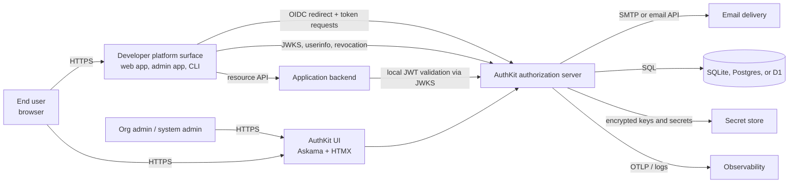
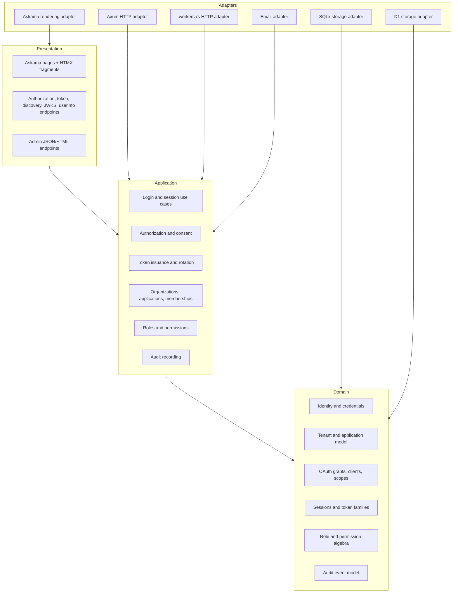
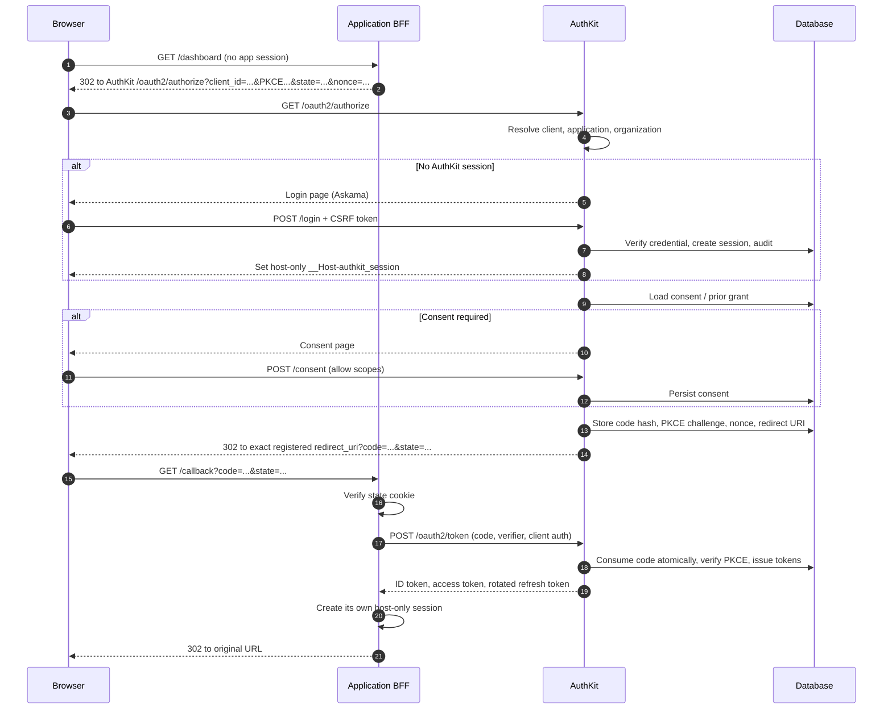
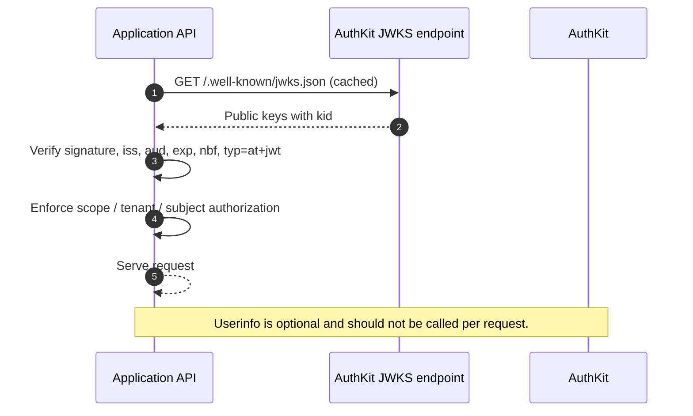
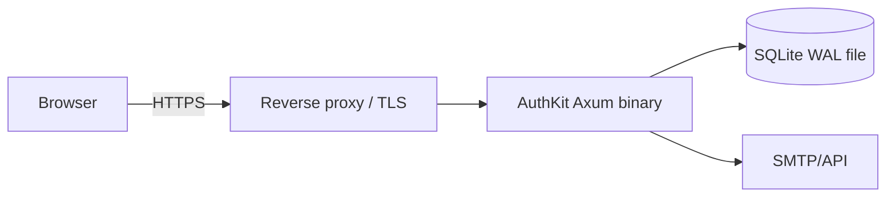
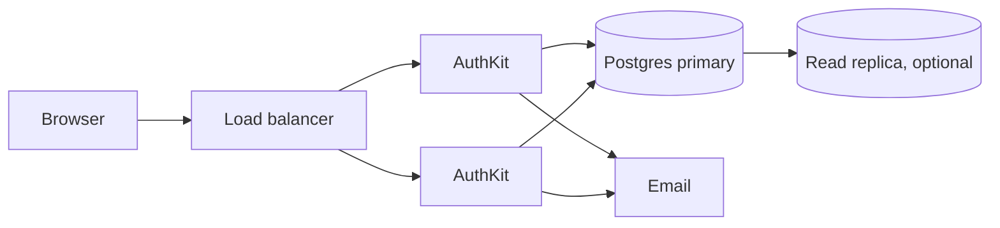
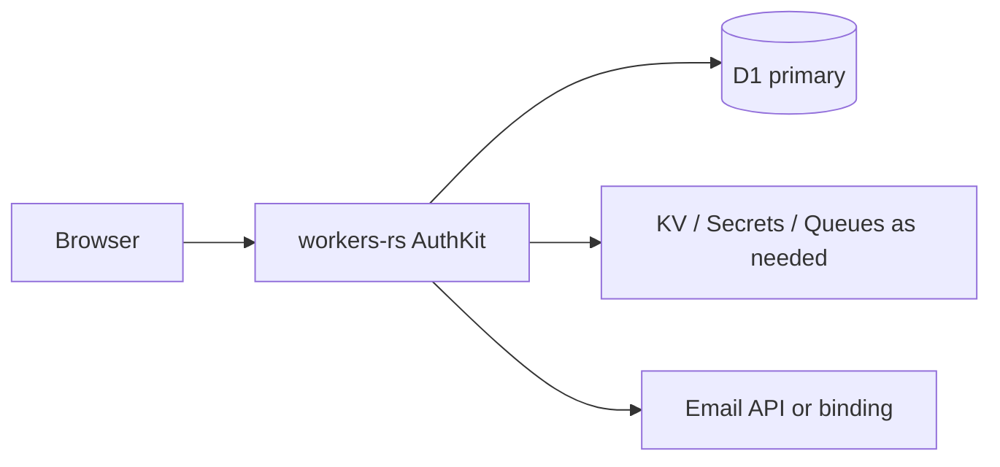

# AuthKit architecture

AuthKit is a planned open-source identity provider for developer platforms. It is a
self-hostable OIDC/OAuth 2.0 authorization server with a server-rendered administration
and account UI. The same domain behavior must run on a native Rust host (Axum + SQLx +
SQLite/Postgres) and on Cloudflare Workers (workers-rs + D1), with a deliberately smaller
feature set on Workers where the platform cannot provide equivalent guarantees.

Related documents:

- [Domain model](domain-model.md)
- [Runtime targets](runtime-targets.md)
- [UI stack](ui-stack.md)
- [Standards and conformance](standards.md)

## 1. Goals, constraints, and non-goals

### Goals

- A correct, auditable OIDC/OAuth 2.0 authorization server that a developer platform can
  self-host without operating a second control plane.
- Organizations (workspaces) as the tenant boundary, with applications as product
  surfaces inside a tenant rather than separate tenants.
- A portable domain core that does not import Axum, workers-rs, SQLx, D1, Askama, or
  browser-cookie types.
- One canonical issuer per deployment, recommended as `https://auth.<apex>` (for example,
  `https://auth.example.com`). Path-based issuers such as `https://example.com/auth` are
  discouraged because they complicate discovery, cookie scope, reverse-proxy routing, and
  migration.
- Host-only cookies. No parent-domain cookies such as `Domain=example.com`.
- A first-class administration experience built with Askama, HTMX, and
  shadcn-inspired primitives, with a no-JavaScript baseline.
- A deployment small enough for a single binary and a SQLite file, yet able to scale to
  Postgres and multiple replicas.
- Any application that speaks OIDC can integrate. AI Gateway is one planned consumer, not
  a dependency of the core product.

### Non-goals for v1

- SAML, SCIM, LDAP, or other enterprise directory protocols.
- Outposts, per-application connectors, or an auth proxy that fronts arbitrary upstream
  applications.
- A visual authentication-flow builder. AuthKit ships opinionated flows and a fixed
  extension surface.
- Social login breadth as a product goal. Upstream OIDC federation may exist as a
  configuration option, but it must not become a general identity-broker feature set in
  v1. **Decision pending:** whether upstream OIDC federation is in v1 or a follow-up.
- Parent-domain SSO, shared cookies across subdomains, or implicit-flow browser clients.
- A React single-page application as the default UI. See [UI stack](ui-stack.md).

### Architectural invariants

1. **The domain core is transport- and storage-agnostic.** It can be compiled and tested
   without a database, HTTP server, template engine, or Workers runtime.
2. **Tenant identity is explicit.** Every tenant-scoped use case receives a
   `TenantContext`; repositories require it. There is no ambient "current organization."
3. **Applications are not tenants.** An application belongs to exactly one organization
   and may expose several OAuth clients (web, admin, native, service). Isolation,
   membership, roles, and data residency are organization concerns.
4. **System administration is separate from tenant administration.** AuthKit system
   administrators are a built-in, deployment-level role. Organization and application
   roles are composable and tenant-scoped.
5. **Critical writes are atomic commands, not arbitrary interactive transactions.**
   The portable core describes reads, decisions, and a guarded write batch. Each runtime
   executes that batch in its native transaction mechanism. This is what allows the same
   use case to run on SQLx and on D1, which has no interactive transactions.
6. **The issuer is deployment-wide and immutable for the lifetime of client
   registrations.** Organizations share an issuer; they are separated by tenant
   identifiers, membership, and authorization, not by issuer URLs.
7. **Browser credentials are host-only and HttpOnly.** Access and refresh tokens are not
   stored in browser-accessible storage in the default architecture.

## 2. System context



Actors and trust boundaries:

| Actor | Trust | Notes |
| --- | --- | --- |
| End user | Untrusted browser | Holds only host-only session cookies for the origins it visits. |
| Application frontend/BFF | Confidential client | Holds its own session and, server-side, its OAuth client credentials and tokens. |
| Application resource server | Trusted verifier | Validates access tokens locally; never trusts identity headers from the internet. |
| Organization admin | Authenticated tenant principal | Manages only its organization, memberships, applications, and clients. |
| AuthKit system admin | Deployment operator principal | Manages deployment-level settings, organizations, signing keys, and break-glass operations. |
| AuthKit server | Policy decision point | Owns sessions, credentials, authorization decisions, token issuance, and audit. |
| Database | Trusted infrastructure | Contains credential verifiers, token hashes, audit events, and encrypted key material. |
| Email provider | External processor | Receives only the minimum content needed for verification and notification. |

The most important boundary is between the **application surface** and **AuthKit**. The
application never receives a user's AuthKit session cookie, and AuthKit never receives the
application's session cookie. They communicate with OAuth redirects and back-channel token
requests, and each origin sets its own host-only cookie.

## 3. Planes and boundaries

AuthKit is organized into four planes. The separation is logical and enforced by module
dependencies; it is not a requirement to deploy four services.



- **Identity/data plane:** authorization, login, session management, token issuance,
  userinfo, JWKS, revocation, and resource-facing verification metadata.
- **Control plane:** organizations, applications, OAuth clients, roles, permissions,
  memberships, signing-key metadata, and audit review. The control plane is low-volume and
  strongly consistent; the data plane is higher-volume and latency-sensitive.
- **Presentation plane:** server-rendered pages and HTMX fragments. It calls application
  use cases in-process; it does not call a private HTTP API.
- **Runtime adapter plane:** Axum versus workers-rs, SQLx versus D1, and OS services versus
  Workers bindings. Adapters translate types; they never contain authorization policy.

### Tenant boundary rules

- An organization is the tenant. Its ID is present on every tenant-owned row and is
  required by every tenant-scoped repository method.
- An application is a surface owned by one organization. It is not an isolation boundary.
  A user can be a member of several organizations and can access applications in each.
- OAuth clients belong to an application. A client ID is globally unique within the
  deployment, but the client's tenant is derived from its application and cannot be
  supplied by the client at runtime.
- Roles are scoped to an organization or an application. Permission checks combine
  organization membership, application access, and role bindings.
- System-admin operations use a separate authorization path and are audited as
  deployment-level events. They must not be reachable through organization-admin routes.

## 4. Modular monolith and crate layout

AuthKit starts as a modular monolith. The authorization server, admin UI, and account UI
share a process and a database. This keeps invariants transactional, reduces operational
surface, and makes the self-hosted story credible. Module boundaries are designed so that
high-volume token verification or email delivery can be extracted later without changing
the domain.

The first version uses four crates. Each crate contains internal modules; a module can be
extracted into its own crate later if a concrete need appears. Starting with four crates
keeps the dependency graph small and the build fast, without weakening the module rules.

| Crate | Responsibility | May depend on |
| --- | --- | --- |
| `authkit-core` | Domain entities and invariants, ports, application use cases, permission algebra, grant state machines, domain errors. No HTTP, SQL, template, or runtime types. | `std`, small utility crates only |
| `authkit-store` | SQLx repositories for SQLite and Postgres, migrations, transaction and guarded-batch execution. The D1 adapter lives behind the `d1` feature. | `authkit-core`, SQLx, D1 bindings |
| `authkit-server` | Axum application, configuration, middleware, Askama/HTMX UI, static assets, email and job adapters, administrative CLI subcommands. | `authkit-core`, `authkit-store`, Axum, Askama |
| `authkit-worker` | workers-rs entry point, Workers bindings, D1 storage, and the Workers-lite feature gates. | `authkit-core`, workers-rs |

Dependency direction:

```text
authkit-server ─┐
                ├──> authkit-core
authkit-store ──┤
authkit-worker ─┘
```

Inside `authkit-core`:

```text
application ──> ports ──> domain
```

Rules:

- The domain module must not depend on the ports module. Ports are shaped around domain
  types, not the reverse.
- Application services accept trait objects or generics over ports; they never import a
  concrete adapter.
- `authkit-store` and the HTTP/UI layers are adapters. They may depend on `authkit-core`,
  never the reverse.
- HTTP adapters map transport errors to RFC 6749/OIDC error responses. Domain errors carry
  stable codes that adapters translate.
- Templates receive view models, never domain entities. This prevents accidental display
  of sensitive fields and keeps templates independent of persistence.
- Cross-module calls go through application services. A module does not query another
  module's tables directly.
- CLI commands (`migrate`, `bootstrap`, `key rotate`, `audit export`) are subcommands of
  the `authkit-server` binary. A separate CLI crate is not justified yet.
- A crate split is recorded as an ADR with the measured reason (build time, dependency
  isolation, or reuse), not as speculative architecture.

### Port surface

The exact Rust signatures will evolve, but the port categories are stable:

| Port | Purpose | Runtime notes |
| --- | --- | --- |
| `UserRepository`, `OrganizationRepository`, `ApplicationRepository` | Aggregate reads and guarded writes. | All tenant-owned methods require `TenantContext`. |
| `ClientRepository` | OAuth client lookup, secret verifier rotation, redirect URI registration. | Client IDs are deployment-global. |
| `MembershipRepository`, `RoleRepository` | Membership and role-binding queries. | Permission checks must be expressible as one query or a bounded set. |
| `SessionRepository` | Session creation, rotation, idle/absolute expiry, revocation. | Auth-critical reads should target the primary on D1. |
| `GrantRepository` | Authorization codes, consents, refresh-token families, revocation records. | One-time consumption must be a conditional write. |
| `AuditSink` | Append-only audit events and export. | Must not block the user response; use an outbox or batch. |
| `KeyStore` | Active signing key, public JWKS, rotation state. | Backed by encrypted DB rows or platform secret storage. |
| `Clock`, `IdGenerator` | Deterministic testing and portable IDs. | Injected; no direct `SystemTime` or `Uuid::now_v7()` in domain logic. |
| `PasswordHasher` | Argon2id and parameter policy. | Native only unless the Workers decision says otherwise. |
| `TokenSigner`, `TokenHasher` | JWT signing and opaque-token hashing. | Asymmetric signing only for OIDC tokens. |
| `EmailSender` | Verification, password reset, security notifications. | Native SMTP/API; Workers email binding or API. |
| `JobQueue` | Outbox dispatch, cleanup, key-rotation checks. | Native background task; Workers Queues/Cron. |
| `RateLimiter` | Login, token, and email abuse controls. | In-process, DB-backed, or platform KV/DO depending on runtime. |
| `SecretBox` | Encryption of signing keys and client secrets at rest. | Key material from env/file or platform secret binding. |
| `Cache` | Optional JWKS/discovery caching and negative lookups. | Must never be the source of truth for revocation. |

### Atomic command model

A use case performs this sequence:

1. Load the minimum state needed, using repository reads scoped by tenant.
2. Evaluate domain policy and construct new values (IDs, hashes, timestamps, tokens).
3. Submit a **guarded write batch** to the store. Each write includes a compare-and-set
   condition where a race matters (for example, `consumed_at IS NULL` for an authorization
   code, or `version = ?` for a membership update).
4. If the batch fails a guard, re-read and return a conflict or a safe OAuth error. Do not
   retry blindly for one-time grants.

The native adapter executes the batch inside a SQL transaction. The D1 adapter executes a
D1 `batch()` and uses the same guards. Because no read occurs inside the transaction, the
core does not need interactive transactions. See [Domain model](domain-model.md) for the
schema implications and [Runtime targets](runtime-targets.md) for D1 caveats.

## 5. Request flows

### 5.1 Authorization code with PKCE (BFF application)



Key properties:

- The authorization code is single-use, short-lived, bound to the client, redirect URI,
  PKCE challenge, nonce, and the authenticated subject. It is stored as a hash.
- `state` is generated and verified by the application, not AuthKit. AuthKit echoes it
  without interpreting it.
- `nonce` is generated by the application and bound into the ID token.
- Redirect URIs use exact string matching. Loopback redirects for native clients follow the
  OAuth rules in [Standards](standards.md).
- The tenant is derived from the OAuth client's application, which belongs to exactly one
  organization in v1. AuthKit does not accept an arbitrary tenant parameter from clients.
  The user must have an active membership in that organization. **Decision pending:**
  whether applications may later be shared across organizations, which would require an
  explicit organization-selection step before consent.

### 5.2 Token validation by an application resource server



Local validation is the default. Opaque access tokens and introspection are supported only
where a deployment explicitly needs them; introspection is not on the hot path. Revocation
semantics are covered in [Standards](standards.md).

### 5.3 Refresh rotation

1. The client presents a refresh token to `/oauth2/token` with
   `grant_type=refresh_token`.
2. AuthKit hashes the presented token, loads the token family, and verifies that the
   token has not been consumed or revoked.
3. In one guarded batch, AuthKit marks the old token consumed, creates a successor, and
   records a reuse-detection event if the old token was already consumed.
4. If reuse is detected, the entire family is revoked and an audit event is written.
5. The response includes a new access token and a new refresh token. The old refresh token
   is never accepted again.

### 5.4 Admin request

Organization admin pages are served by the same Askama BFF. The session identifies the
user; the use case resolves memberships and permissions for the selected organization.
Every mutating request is a same-origin form POST with a CSRF token. The UI never sends a
tenant ID that it has not also authorized against the session's memberships. System-admin
pages use a distinct route prefix, distinct permission checks, and stronger session
requirements. **Decision pending:** whether system administrators require a separate
session audience, WebAuthn, or step-up authentication.

## 6. BFF choice

The default browser architecture is a backend-for-frontend:

- The browser holds a host-only, HttpOnly, Secure session cookie for the application's own
  origin. It never holds OIDC access or refresh tokens.
- The application backend is a confidential OAuth client. It performs the authorization
  code exchange, stores tokens server-side, and refreshes them when needed.
- The application renders or proxies what the browser needs. Cross-origin API calls from
  the browser are avoided or mediated by the BFF.
- AuthKit's own UI is also a BFF in the sense that it renders server-side and uses a
  host-only session cookie. It does not need to run an OAuth flow against itself.

Why this is the default:

- Tokens are not exposed to XSS in browser storage.
- Refresh tokens remain server-side and can be rotated and revoked without browser
  involvement.
- CSRF defense is simpler with same-origin forms and SameSite cookies.
- The application can keep its own authorization model separate from OIDC scopes.
- Host-only cookies work naturally: `app.example.com` and `auth.example.com` each have
  their own cookie, and no cookie is shared across the apex.

Costs:

- Every browser-facing application needs a small server component.
- The BFF must implement session storage, CSRF, and logout coordination.
- Mobile and CLI clients use native OAuth public-client flows instead of the BFF.

**Decision pending:** whether AuthKit ships a reusable BFF library or only documentation
and sample integrations. A library risks coupling to one web framework; documentation plus
a thin reference implementation is the lower-risk starting point.

## 7. Token validation and key management

- OIDC tokens are signed with asymmetric keys. The default recommendation is ES256;
  EdDSA may be offered where the runtime and client ecosystem support it. HS256 is not
  used for OIDC clients.
- Public keys are published at the discovery-advertised `jwks_uri` with stable `kid`
  values. Private keys are never returned by any endpoint.
- Access tokens use `typ=at+jwt` (RFC 9068) and a short lifetime. ID tokens use
  `typ=JWT` or the OIDC-compatible default and are audience-bound to the client.
- Validation checks signature, `iss` exact match, `aud`, `exp`, `nbf` with a small clock
  skew, `iat` sanity, `kid` selection, and token type. Resource servers must not accept
  ID tokens as access tokens.
- Signing keys have states: `next` (published, not signing), `active` (signing), and
  `retired` (published until the maximum token lifetime has elapsed). Rotation is a
  controlled operation with audit.
- Key storage differs by runtime. Native deployments encrypt private keys at rest with a
  master key supplied by the environment or a KMS. Workers deployments use platform
  secret storage. See [Runtime targets](runtime-targets.md).
- Revocation is enforced by short access-token TTLs, refresh-token family revocation, and
  session revocation. A resource server that requires immediate access-token revocation
  must use introspection or a deployment-specific denylist; AuthKit does not pretend that
  stateless JWTs are instantly revocable.

## 8. Why no auth proxy and no outposts

A reverse auth proxy (forward-auth, `X-Auth-Request-*` headers, or a per-app connector)
is intentionally out of scope:

- It requires routing every protected request through AuthKit, including static assets,
  WebSockets, and non-HTTP protocols.
- It encourages applications to trust identity headers, which is unsafe unless the network
  path is airtight and the application is unreachable directly.
- It conflicts with host-only cookies when apps live on different registrable domains.
- It turns AuthKit into a traffic dependency and a single point of failure for every
  application, not just an identity dependency.
- It does not fit the product model: applications are surfaces inside an organization,
  not arbitrary upstream services to be gated.

An "outpost" model (a agent or connector in each network) adds deployment and trust
complexity that v1 does not need. Applications integrate with OIDC directly. A reverse
proxy may still be placed in front of AuthKit for TLS termination or WAF, but it must not
inject authenticated identity for upstream apps.

Access tokens and JWKS are the integration surface. If an application cannot validate a
JWT, it can use userinfo or introspection server-side, but that is an application choice.

## 9. Deployment topologies

### 9.1 Native single node with SQLite



Suitable for small teams and single-region deployments. One writer, local disk, backup by
snapshot or a SQLite-aware replication tool. Session affinity is trivial because there is
one node. This is the simplest full-feature topology.

### 9.2 Native horizontally scaled with Postgres



Use Postgres when multiple replicas, larger audit volume, or managed backups are needed.
All authorization-critical reads and writes go to the primary. Read replicas may serve
reporting and audit browsing with an explicit staleness budget. Sessions are stored in the
database, not in process memory, so any replica can serve a request.

### 9.3 Workers with D1 (Workers-lite)



The Workers target is a constrained feature set. It is appropriate when the deployment is
already Cloudflare-native and the tenant size fits D1's limits. It is not a drop-in
replacement for the full native runtime. SQLx does not run on Workers, and D1 has no
interactive transactions. See [Runtime targets](runtime-targets.md).

### 9.4 Cloudflare Containers escape hatch

If a deployment needs full AuthKit behavior on Cloudflare, run the native container image
and connect it to a supported Postgres instance. Workers can provide the front door, TLS,
WAF, and static assets, but the authorization server remains the native binary. This
preserves SQLx, Argon2, background jobs, and interactive transactions at the cost of
container cold starts, regional placement, and a database dependency outside D1.
**Decision pending:** whether this topology is officially supported or documented as
community-supported.

### Topology comparison

| Property | SQLite single node | Postgres multi-replica | Workers + D1 | Container + Postgres |
| --- | --- | --- | --- | --- |
| Feature completeness | Full | Full | Workers-lite | Full |
| Operational simplicity | High | Medium | High | Medium |
| Horizontal scale | No | Yes | Platform-managed | Yes (with DB limits) |
| Transaction model | Interactive SQL | Interactive SQL | Batched, guarded writes | Interactive SQL |
| Password hashing | Argon2id | Argon2id | Restricted / decision pending | Argon2id |
| Key storage | Encrypted DB + env master key | Encrypted DB + KMS/env | Worker secret | Encrypted DB + KMS/env |
| Email | SMTP/API | SMTP/API | Email binding/API | SMTP/API |
| Best fit | Small self-host | Production native | Edge, small tenants | Cloudflare-native full feature |

## 10. Cross-cutting operations

- **Configuration:** a single typed configuration loader per runtime. Secrets are never
  logged. The issuer URL is validated at startup and must be HTTPS outside local
  development.
- **Migrations:** one logical migration series with dialect-specific SQL where necessary.
  CI runs migrations on SQLite, Postgres, and D1 before tests. Migrations are forward-only;
  destructive changes require an expand/contract sequence.
- **Backups:** SQLite snapshots or WAL-aware backup; Postgres managed backups; D1 export
  or Time Travel where available. Signing keys and secrets are backed up separately and
  encrypted.
- **Observability:** structured logs with request IDs and tenant IDs (never tokens,
  passwords, or full email bodies), metrics for login/token/authorization latency and
  error rates, and OTLP traces where supported. Workers uses the platform's observability
  primitives.
- **Rate limiting:** login, password reset, email verification, token exchange, and
  introspection have separate budgets. Rate-limit state is not the source of truth for
  account lockout.
- **Audit:** security-relevant events are written through the outbox/batch path. Audit
  writes must not be silently dropped; if the sink is unavailable, the operation either
  fails closed where appropriate or records a durable local intent. **Decision pending:**
  whether audit uses a hash chain for tamper evidence.
- **Data retention:** audit, session, and token-retention windows are configurable.
  Expired rows are removed by a scheduled job. Retention is a deployment policy.

## 11. Open decisions

The following are explicitly unresolved. They are marked **Decision pending** and should
be resolved in ADRs before implementation depends on them.

1. **Workers-lite feature boundary.** Which of password login, MFA, email verification,
   audit export, and admin UI are available on Workers.
2. **Password hashing on Workers.** Argon2id in WASM versus PBKDF2/WebCrypto versus
   disabling password auth on Workers. See [Runtime targets](runtime-targets.md).
3. **Access-token tenant claim and shared applications.** The claim name and whether it is
   always present. V1 derives the tenant from the client's application, which belongs to
   one organization. Whether applications may later be shared across organizations is a
   separate product decision that would change authorization-time tenant selection.
4. **Consent policy.** Auto-consent for first-party applications owned by the same
   organization versus a consent screen for every client. The default proposal is
   auto-consent only for clients marked first-party by a system administrator, with an
   audit event.
5. **Signing algorithm and key custody.** ES256 as default; EdDSA support; native KMS
   integration; Workers key rotation mechanics.
6. **BFF distribution.** Documentation and sample only, or a maintained library.
7. **System-admin authentication strength.** Separate session audience, WebAuthn, or
   step-up.
8. **Upstream OIDC federation.** In scope for v1 or deferred.
9. **Audit tamper evidence.** Hash chain versus append-only table with export.
10. **Access-token format for Workers-lite.** JWT with local validation versus opaque
    tokens with introspection, given D1 read-replication behavior.

Cross-references: [domain model](domain-model.md), [runtime targets](runtime-targets.md),
[UI stack](ui-stack.md), [standards](standards.md).
