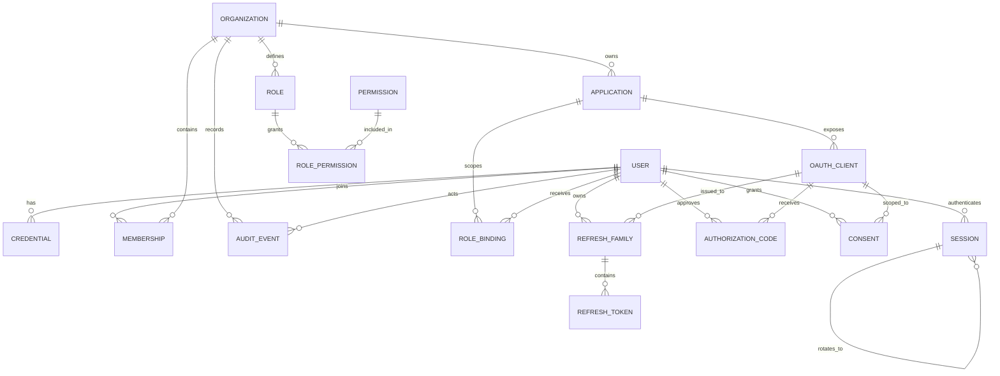

# AuthKit domain model

This document defines the portable domain model. It is the contract that the Axum/SQLx and
workers-rs/D1 adapters implement. The model is intentionally narrower than a general
identity platform: users, organizations (tenants), applications, OAuth clients,
memberships, roles, permissions, sessions, grants, and audit.

Related documents:

- [Architecture](architecture.md)
- [Runtime targets](runtime-targets.md)
- [UI stack](ui-stack.md)
- [Standards](standards.md)

## 1. Modeling principles

1. **Organizations are tenants.** An organization (also called a workspace in the UI) owns
   memberships, applications, role definitions, and tenant audit. Tenant isolation is
   enforced by carrying an explicit organization ID through every tenant-scoped use case.
2. **Applications are surfaces, not tenants.** An application is a web app, admin app,
   client app, or service surface owned by one organization. It can have multiple OAuth
   clients. It does not own users or memberships.
3. **Users are deployment-global identities.** A user can belong to several organizations
   with different roles. Email is unique across the deployment, normalized at the
   boundary.
4. **Authorization is composed, not hard-coded.** Built-in roles provide safe defaults,
   but permissions are granular strings and roles are sets of permissions. Application and
   organization roles are separate scopes. AuthKit system administration is a separate,
   built-in scope.
5. **Credentials are separate from identities.** A user can have a password credential,
   passkey credentials, and future credential types without changing the user row.
6. **Tokens and sessions are revocable state.** The database stores hashes and lifecycle
   metadata, never bearer tokens in plaintext.
7. **Audit is append-only.** Audit rows are written once and never updated through normal
   application paths.
8. **The schema is portable.** IDs are application-generated text, timestamps are
   application-generated integers, JSON is stored as text, enums are text plus checks, and
   critical writes use conditional batches rather than interactive transactions.

## 2. Aggregate map



The diagram is logical. Some relationships are represented by join tables and some
entities (permissions, role bindings, refresh tokens) are shown only at the level needed to
explain ownership.

## 3. Entities

### 3.1 User

A global identity. Users do not belong to an organization directly; membership is a
separate entity. A user may be suspended without deleting memberships or audit history.

| Field | Type | Notes |
| --- | --- | --- |
| `id` | text | Prefixed ID, for example `usr_...`. Primary key. |
| `email` | text | Normalized lowercase, trimmed. Unique deployment-wide. |
| `email_verified_at` | integer nullable | Epoch milliseconds. Set only by a verified flow. |
| `display_name` | text | User-editable. Not an authorization input. |
| `status` | text | `active`, `suspended`, `deleted`. Check-constrained. |
| `created_at`, `updated_at` | integer | Epoch milliseconds, application clock. |
| `version` | integer | Optimistic concurrency for profile updates. |

Rules:

- Email changes require re-verification and emit audit events. **Decision pending:** whether
  an email change also revokes sessions and notifies the old address.
- A suspended user cannot authenticate, but existing access tokens remain valid until
  expiry unless sessions and refresh families are revoked as part of suspension. Suspension
  revokes sessions and refresh families by default.
- Deletion is a state transition plus a retention process; audit rows are not deleted with
  the user. Direct identifiers in audit are minimized or pseudonymized according to
  deployment retention policy.

### 3.2 Organization (workspace)

The tenant boundary.

| Field | Type | Notes |
| --- | --- | --- |
| `id` | text | `org_...`. |
| `slug` | text | Unique, lowercase ASCII, URL-safe. Public identifier. |
| `name` | text | Display name. |
| `status` | text | `active`, `suspended`, `deleted`. |
| `settings` | text | JSON object serialized as text. Validated by the application. |
| `created_at`, `updated_at` | integer | Epoch milliseconds. |
| `version` | integer | Concurrency control. |

Rules:

- The slug is unique deployment-wide. Renaming a slug may break bookmarks; the old slug is
  not silently redirected unless a deployment enables aliases. **Decision pending:**
  organization slug aliases.
- Suspending an organization blocks new authorizations and administrative changes but does
  not delete data. Existing sessions and tokens are revoked by an explicit operation, not
  implicitly by a status read on every request.
- Tenant-scoped tables carry `org_id`. A query without an `org_id` predicate is allowed
  only in system-administration code and deployment-level maintenance.

### 3.3 Application

A product surface owned by exactly one organization. Examples: "Console", "Admin",
"Desktop", "API". An application is not a tenant and must not be used as an isolation
boundary.

| Field | Type | Notes |
| --- | --- | --- |
| `id` | text | `app_...`. |
| `org_id` | text | FK to organization. Immutable after creation. |
| `slug` | text | Unique within the organization. |
| `name` | text | Display name. |
| `kind` | text | `web`, `admin`, `native`, `service`, `cli` (extensible, check-constrained). |
| `first_party` | integer | `0`/`1`. Set by a system administrator or trusted deployment config. |
| `status` | text | `active`, `disabled`. |
| `created_at`, `updated_at` | integer | Epoch milliseconds. |
| `version` | integer | Concurrency control. |

Why applications are not tenants:

- Tenant isolation is about who can see and administer data, billing boundaries, and
  membership. Applications are deployable surfaces that share the organization's users,
  roles, and audit.
- A user with one membership should be able to use every application in that organization
  without accepting a separate membership per app.
- OAuth clients are already the correct unit for "a web client" or "a CLI client". Making
  applications tenants duplicates that concept and creates cross-tenant token problems.
- The same application can expose a browser BFF client and a service client with different
  credentials, redirect URIs, and scopes.

Cross-organization access is not modeled in v1. If a future "partner application" feature
is needed, it should be an explicit grant or organization link, not an application that
belongs to two organizations. **Decision pending:** whether applications may later be
shared across organizations. V1 binds each application to one organization; a shared
application would require a separate organization-selection and consent design.

### 3.4 OAuth client

A client registration used by one application surface.

| Field | Type | Notes |
| --- | --- | --- |
| `id` | text | `cli_...`, internal row ID. |
| `client_id` | text | Public identifier, globally unique, random and non-sequential. |
| `application_id` | text | FK to application. Determines tenant. |
| `name` | text | Human-readable client name. |
| `client_type` | text | `confidential` or `public`. |
| `token_endpoint_auth_method` | text | `client_secret_basic`, `client_secret_post`, or `none`. |
| `secret_hash` | text nullable | Keyed hash of the current secret. Not an Argon2 password hash. |
| `secret_rotated_at` | integer nullable | Epoch milliseconds. |
| `require_pkce` | integer | `1` for public clients and BFFs recommended. |
| `status` | text | `active`, `disabled`. |
| `created_at`, `updated_at` | integer | Epoch milliseconds. |
| `version` | integer | Concurrency control. |

Related tables:

- `oauth_client_redirect_uris`: exact URI, client ID, created time. Unique per client and
  URI. **Decision pending:** whether loopback redirects are normalized against the RFC 8252
  port rule or matched exactly with port wildcarding.
- `oauth_client_scopes`: allowed scopes per client.
- `oauth_client_grant_types`: authorization code, refresh token, client credentials.
- `oauth_client_post_logout_redirect_uris`: exact matching for RP-initiated logout.

Rules:

- `client_id` is globally unique and generated by the server. It is not derived from the
  application slug.
- Client secrets are high-entropy random values. Store an HMAC-SHA-256 hash with a
  deployment pepper, not Argon2id, because token endpoint verification must be cheap and
  the secret already has sufficient entropy. Compare in constant time.
- A confidential client may have at most two active secrets during a rotation window.
  **Decision pending:** the exact overlap policy. The safe default is one current secret
  plus one previous secret with an explicit expiry, both stored hashed.
- Public clients have no secret and must use PKCE. They are appropriate for native and CLI
  clients, not for browser SPAs in the default architecture.
- Redirect URI changes are security-sensitive and audited. Wildcards are not allowed.
- Disabling a client rejects new authorization requests and token exchanges and revokes
  its refresh families. It does not retroactively revoke already issued JWTs; short access
  token lifetimes bound that exposure.

### 3.5 Membership

Links a user to an organization.

| Field | Type | Notes |
| --- | --- | --- |
| `id` | text | `mem_...`. |
| `org_id` | text | FK. |
| `user_id` | text | FK. |
| `status` | text | `invited`, `active`, `suspended`, `removed`. |
| `invited_by` | text nullable | User ID. |
| `joined_at` | integer nullable | Epoch milliseconds. |
| `created_at`, `updated_at` | integer | Epoch milliseconds. |
| `version` | integer | Concurrency control. |

Constraints and rules:

- Unique `(org_id, user_id)`.
- Only `active` memberships grant organization permissions.
- Removing a membership revokes that user's sessions scoped to the organization and
  refresh families issued for its applications. **Decision pending:** whether removal
  revokes global sessions or only organization-scoped authorization.
- Invitations are separate from memberships. An invitation stores a hashed token, email,
  intended role bindings, inviter, expiry, and status. It does not create an active
  membership until accepted. **Decision pending:** whether invitations are modeled as
  `membership.status = invited` plus an invite table, or as a standalone invitation
  aggregate. The recommendation is a standalone `organization_invitation` table to avoid
  treating an unaccepted invite as a membership.
- The last active owner cannot be removed or demoted. This invariant is checked with a
  guarded write that counts remaining owners or uses a role-binding version. The exact
  concurrency technique is adapter-specific but the invariant is domain-level.

### 3.6 Role, permission, and role binding

Roles are named sets of permissions. Tenant roles have two scopes:

| Scope | Owner | Examples |
| --- | --- | --- |
| Organization | One organization | `org.member.manage`, `org.application.manage`, `org.audit.read` |
| Application | One application within an organization | `app.client.manage`, `app.user.read`, `app.audit.read` |

System administration is not a tenant role. System administrators are a separate,
deployment-level record with a distinct authorization path and audit events, as described
in [Architecture](architecture.md#3-planes-and-boundaries).

Organization and application roles are composable: organizations can create custom roles
from the permission catalog, subject to the permissions the actor may delegate. The v1
organization roles (`owner`, `admin`, `member`) are seeded and immutable. Application
built-in roles (`admin`, `operator`, `viewer`) are planned; v1 supports custom
application-scoped roles.

The v1 organization permission catalog is:

| Permission | Owner | Admin | Member |
| --- | --- | --- | --- |
| `org.read` | yes | yes | yes |
| `org.manage` | yes | yes | no |
| `org.delete` | yes | no | no |
| `org.member.read` | yes | yes | no |
| `org.member.manage` | yes | yes | no |
| `org.role.read` | yes | yes | no |
| `org.role.manage` | yes | yes | no |
| `org.application.read` | yes | yes | yes |
| `org.application.manage` | yes | yes | no |
| `org.client.manage` | yes | yes | no |
| `org.session.manage` | yes | yes | no |
| `org.audit.read` | yes | yes | no |

The catalog is code-defined and migrated with the application. A custom role may include
only permissions the granting administrator holds.

**Role**

| Field | Type | Notes |
| --- | --- | --- |
| `id` | text | `rol_...`. |
| `org_id` | text | Required. Tenant-owned. |
| `application_id` | text nullable | Set only for application-scoped roles. |
| `scope` | text | `organization` or `application`; derived from `application_id`. |
| `kind` | text | `owner`, `admin`, `member`, or `custom`. |
| `key` | text | Stable machine key (slug), unique within the scope. |
| `name` | text | Display name. |
| `description` | text nullable | Admin-facing description. |
| `immutable` | integer | Derived from `kind != custom`; prevents editing seeded roles. |
| `created_at`, `updated_at` | integer | Epoch milliseconds. |

**Permission**

| Field | Type | Notes |
| --- | --- | --- |
| `key` | text | Primary key, for example `org.member.manage`. The prefix encodes the scope. |
| `description` | text | Admin-facing description. |
| `delegable` | integer | Whether an org admin can grant it to a custom role. |

Permissions are a deployment-level catalog. They are code-defined and migrated with the
application, not freely created by tenants. This prevents typo-permissions and makes
authorization review possible.

**Role binding**

| Field | Type | Notes |
| --- | --- | --- |
| `id` | text | `rbd_...`. |
| `role_id` | text | FK. |
| `user_id` | text | Subject. v1 supports users only. |
| `org_id` | text | Tenant scope, required even for application roles. |
| `application_id` | text nullable | Required for application-scoped bindings. |
| `created_at` | integer | Epoch milliseconds. |
| `created_by` | text | Actor user ID or `system`. |

Constraints:

- Unique `(role_id, user_id, org_id, application_id)` with a portable treatment of nulls.
  Because SQLite, Postgres, and D1 differ on unique-null semantics, use a non-null
  `scope_key` column (for example `org` or `app_<id>`) in the uniqueness constraint, or
  enforce uniqueness with a guarded insert plus a unique index on a generated scope string.
- A binding requires an active membership in the same organization. Application bindings
  additionally require access to that application through the organization.
- Role escalation is prevented in the application layer: an actor cannot grant a
  permission it does not hold, and cannot grant a role it does not hold.
- Built-in owner membership is represented by a binding to the seeded `owner` role. The
  last-owner invariant protects against orphaning an organization.

Permission evaluation:

```text
can(actor, permission, scope):
  require active membership(actor, org)
  require scope.application_id belongs to org (if present)
  union permissions from role bindings for actor at org scope and matching app scope
  allow if permission is present, otherwise deny
```

The check is deny-by-default. UI visibility is not authorization; every use case repeats
the permission check on the server. System-administration operations use a separate
deployment-level check and are audited as deployment events, not tenant permission checks.

### 3.7 Credential

Separate rows per credential type, with a shared lifecycle and type-specific payload. The
domain exposes distinct `Password`, `Passkey`, and `Totp` constructors; there is no generic
"secret hash + kind" constructor.

| Field | Type | Notes |
| --- | --- | --- |
| `id` | text | `cred_...`. |
| `user_id` | text | FK. |
| `type` | text | `password`, `passkey`, or `totp`. |
| `password_verifier` | text nullable | Password rows only. Argon2id PHC string. |
| `webauthn_credential_id` | blob nullable | Passkey rows only. Raw credential ID. |
| `webauthn_public_key` | blob nullable | Passkey rows only. CBOR-encoded COSE key. |
| `webauthn_aaguid` | blob nullable | Passkey rows only. 16-byte authenticator AAGUID. |
| `webauthn_sign_count` | integer nullable | Passkey rows only. Last accepted signature counter. |
| `webauthn_transports` | text nullable | Passkey rows only. Persisted transport hints. |
| `webauthn_discoverable` | boolean nullable | Passkey rows only. |
| `webauthn_backup_eligible` | boolean nullable | Passkey rows only. |
| `webauthn_backup_state` | boolean nullable | Passkey rows only. |
| `totp_ciphertext` | blob nullable | TOTP rows only. AEAD ciphertext, never plaintext. |
| `totp_key_id` | text nullable | TOTP rows only. Key-encryption-key version for rotation. |
| `totp_nonce` | blob nullable | TOTP rows only. AEAD nonce. |
| `totp_algorithm`, `totp_digits`, `totp_period` | text/integer | TOTP rows only. |
| `totp_last_accepted_step` | integer nullable | TOTP rows only. Replay guard. |
| `label` | text | User-visible label. |
| `status` | text | `active`, `disabled`, `revoked`. |
| `created_at`, `last_used_at` | integer | Epoch milliseconds. |
| `version` | integer | Concurrency control. |

Rules:

- Never store plaintext passwords or password-equivalent secrets.
- Password verifiers are Argon2id PHC strings with per-hash salts. The domain accepts only
  Argon2id version 19, at least 19 MiB memory, two passes, one lane, a 16-64 byte salt, and
  a 32-byte output. Parameter changes trigger rehash on successful login.
- Passkey rows store the raw credential ID, the COSE public key, the AAGUID, transport
  hints, discoverability, and backup flags. A non-zero signature counter must increase on
  every authentication; a regression fails closed as a possible cloned authenticator. A
  zero counter is accepted for authenticators that do not implement clone detection.
- TOTP secrets are encrypted with an AEAD adapter before they reach storage. The
  key-encryption key comes from the deployment secret store, and `totp_key_id` records the
  key version so secrets can be re-encrypted during rotation. The core never sees plaintext
  TOTP secrets.
- The adapter computes the TOTP time step after verifying the code. `totp_last_accepted_step`
  is monotonic: a step that is equal to or lower than the stored step is rejected as a
  replay, and rotating the secret clears the step.
- Disabling a credential is reversible; revocation is terminal. Revoked rows are retained
  for audit and recovery investigation and are deleted only with the owning user.
- Passkeys/WebAuthn and TOTP are not confirmed for v1. **Decision pending:** MFA scope.
  If included, they use this model rather than adding columns to `user`.
- One-time tokens (email verification, password reset, invitation acceptance, magic link if
  ever supported) live in `one_time_token`: hashed token, user or invitation reference,
  purpose, `expires_at`, `consumed_at`, `created_at`, and request metadata. They are
  single-use and consumed with a guarded update.
- Password reset does not reveal whether an email exists. The response is always generic.
- Password policy is length-first (minimum 12 characters, allow long passphrases, no
  composition rules, reject known-breached passwords if a breach-list integration exists).
  **Decision pending:** breach-list integration and maximum length.

### 3.8 Session

A server-side browser session for AuthKit's own UI and admin surfaces.

| Field | Type | Notes |
| --- | --- | --- |
| `id` | text | `ses_...`. |
| `user_id` | text | FK. |
| `token_hash` | text | Hash of the opaque cookie value. Unique. |
| `csrf_hash` | text | Hash of the CSRF token or a per-session CSRF secret. |
| `audience` | text | `ui`, `admin`, or both (check-constrained). |
| `active_org_id` | text nullable | UI selection only; not an authorization grant by itself. |
| `auth_time` | integer | When the user last authenticated. |
| `amr` | text | JSON array serialized as text, for example `["pwd"]`. |
| `idle_expires_at` | integer | Absolute idle timeout. |
| `expires_at` | integer | Absolute session lifetime. |
| `revoked_at` | integer nullable | Set on logout, suspension, or compromise. |
| `rotated_from` | text nullable | Previous session ID after rotation. |
| `ip_hash`, `user_agent_hash` | text nullable | Privacy-preserving request context. |
| `created_at`, `last_seen_at` | integer | Epoch milliseconds. |
| `version` | integer | Concurrency control. |

Rules:

- The cookie contains a 256-bit random opaque value. Only its hash is stored. The raw value
  is never logged.
- Cookies are host-only, `Secure`, `HttpOnly`, `SameSite=Lax`, and use the `__Host-` prefix
  where compatible. No `Domain` attribute.
- Rotate the session token on successful login, privilege change, organization switch that
  changes authorization, and periodic rotation. Rotation creates a new row and revokes the
  old one with `rotated_from` for traceability.
- Idle and absolute timeouts are configuration. Last-seen updates are throttled to avoid a
  write on every request.
- Session revocation is checked on every AuthKit request. JWTs issued to applications are
  not session-bound by default; logout at AuthKit does not instantly revoke application
  access tokens. See [Standards](standards.md).
- **Decision pending:** whether sessions are bound to a device fingerprint. The default is
  no, because fingerprints are unstable and create false security.

### 3.9 Authorization code, consent, and refresh family

**Authorization code**

| Field | Type | Notes |
| --- | --- | --- |
| `id` | text | `ac_...`. |
| `code_hash` | text | Unique. Hash of the code. |
| `client_id` | text | FK by public client_id or internal client ID. |
| `user_id` | text | Authenticated subject. |
| `org_id` | text | Tenant at authorization time. |
| `redirect_uri` | text | Exact URI used. |
| `scope` | text | Space-delimited granted scopes. |
| `pkce_challenge`, `pkce_method` | text | `S256` only; `plain` rejected outside tests. |
| `nonce` | text nullable | OIDC nonce, echoed in the ID token. |
| `auth_time` | integer | Authentication time. |
| `expires_at` | integer | Short-lived. |
| `consumed_at` | integer nullable | Set exactly once. |
| `created_at` | integer | Epoch milliseconds. |

Consumption is a guarded update: `UPDATE ... SET consumed_at = ? WHERE code_hash = ? AND
consumed_at IS NULL AND expires_at > ?`. A zero-row result is invalid or reused; both are
audited. If a code is replayed, revoke the tokens issued from it where traceable.

**Consent**

| Field | Type | Notes |
| --- | --- | --- |
| `id` | text | `cns_...`. |
| `user_id` | text | FK. |
| `client_id` | text | FK. |
| `org_id` | text | Tenant context. |
| `scope` | text | Granted scopes. |
| `created_at`, `updated_at` | integer | Epoch milliseconds. |
| `revoked_at` | integer nullable | Consent withdrawal. |

Consent is per user, client, and organization. Scopes not covered by a prior consent
require a new consent screen. First-party auto-consent is **Decision pending**; if enabled,
it must still be visible in the UI and auditable.

**Refresh family and refresh token**

| Entity | Key fields |
| --- | --- |
| `refresh_family` | `id` (`rf_...`), `client_id`, `user_id`, `org_id`, `scope`, `created_at`, `revoked_at`, `revocation_reason` |
| `refresh_token` | `id` (`rt_...`), `family_id`, `token_hash` unique, `parent_id`, `expires_at`, `consumed_at`, `revoked_at`, `created_at` |

Rules:

- Every refresh token belongs to exactly one family. Rotation issues a successor in the
  same family.
- Presenting a consumed token is treated as replay: revoke the whole family, audit with
  high severity, and return `invalid_grant`.
- Revoking a family is idempotent. It sets `revoked_at` on the family and all unconsumed
  descendants in a batch.
- Access tokens are not stored by default because they are short-lived JWTs. If a
  deployment enables opaque access tokens, they use a hashed token table with the same
  lifecycle discipline.
- **Decision pending:** refresh-token absolute maximum lifetime and whether sliding expiry
  is allowed. The recommendation is a bounded absolute lifetime with rotation on every use.

### 3.10 Audit event

Append-only security and administration history.

| Field | Type | Notes |
| --- | --- | --- |
| `id` | text | `aud_...`, sortable. |
| `org_id` | text nullable | Null for deployment-level events. |
| `actor_type` | text | `user`, `system`, `client`, `anonymous`. |
| `actor_id` | text nullable | User/client ID when known. |
| `action` | text | Stable event key, for example `session.login.succeeded`. |
| `target_type`, `target_id` | text nullable | Affected entity. |
| `result` | text | `success`, `failure`, `denied`. |
| `reason_code` | text nullable | Stable code, not free-form sensitive text. |
| `ip_hash`, `user_agent_hash` | text nullable | Minimized request context. |
| `metadata` | text | JSON object serialized as text; must be redacted. |
| `created_at` | integer | Epoch milliseconds. |
| `prev_hash` | text nullable | Optional hash-chain link. **Decision pending.** |

Rules:

- Audit rows are inserted through the outbox or the same guarded batch as the state change.
  Normal application code never updates or deletes them.
- Never write passwords, tokens, authorization codes, client secrets, full email bodies, or
  raw IP addresses into audit metadata.
- Events include authentication success/failure, logout, session rotation/revocation,
  password/credential changes, membership changes, role and permission changes, application
  and client changes, key rotation, consent changes, token reuse detection, and
  system-admin actions.
- Query indexes support `(org_id, created_at)`, `(actor_id, created_at)`, and
  `(action, created_at)`. Audit export is streaming and permission-gated.

### 3.11 Supporting tables

- `system_admin`: user ID, granted by, created time. Backed by the system scope role model
  or a dedicated table; **Decision pending:** whether system admin is simply a system-scope
  role binding or a separate deployment table. A dedicated table is easier to protect from
  tenant role APIs.
- `outbox`: event ID, topic, payload, available time, attempts, last error, processed time.
  Used for email, audit fan-out, and cleanup. Workers can drain it with Queues/Cron; native
  uses a background worker.
- `idempotency_key`: key, scope, request hash, response reference, created/expires time.
  Used for admin mutations and token endpoint retries.
- `signing_key`: `kid`, algorithm, public JWK, encrypted private key reference, state,
  created/activated/retired times, version.
- `deployment_setting`: key/value with typed validation. Used only for deployment-level
  configuration that must be editable at runtime; secrets are not stored here.
- `organization_invitation`: org, email, inviter, intended role bindings, token hash,
  expiry, status.

## 4. Identifier strategy

IDs are application-generated, globally unique, sortable, and prefixed by type:

```text
usr_01J...  org_01J...  app_01J...  cli_01J...  mem_01J...
rol_01J...  rbd_01J...  ses_01J...  ac_01J...   rt_01J...
aud_01J...
```

- Use a 128-bit sortable identifier (UUIDv7 or ULID). **Decision pending:** UUIDv7 versus
  ULID. Both can be stored as 26-character Crockford base32 or 36-character UUID text.
  The important properties are application generation, global uniqueness, and stable
  lexical ordering.
- Do not expose database auto-increment values. Do not use email addresses, slugs, or
  client names as primary keys.
- `client_id` is a separate random public identifier (for example, 32 bytes base64url
  without padding). It is not the internal `cli_...` primary key, which makes client-ID
  migration and secret rotation easier to reason about.
- Slugs are for humans and routing. They can change according to policy; IDs cannot.
- All IDs are validated at the boundary (prefix, alphabet, length) before repository calls.

## 5. Cross-cutting schema constraints

### 5.1 Tenant integrity

- Every tenant-owned table has `org_id NOT NULL` and an index beginning with `org_id` for
  its common access path.
- Application-scoped rows carry both `org_id` and `application_id`; the repository verifies
  that the application belongs to the organization. Do not rely on a join in every query to
  enforce this.
- Foreign keys are declared and enabled. SQLite requires `PRAGMA foreign_keys = ON`; D1 and
  Postgres enforce them, but the application still checks ownership because a foreign key
  cannot express "application belongs to this tenant" without a composite key.
- Composite foreign keys may be used where practical:
  `(application_id, org_id) REFERENCES application(id, org_id)`. This is portable across
  SQLite, Postgres, and D1 but requires a unique index on the referenced pair.
- Dedicated system-admin queries are the only ones allowed to omit `org_id`. They live in
  a separate module and are audited.

### 5.2 Uniqueness

| Constraint | Notes |
| --- | --- |
| `user.email` | Normalized lowercase, unique deployment-wide. |
| `organization.slug` | Unique deployment-wide. |
| `application (org_id, slug)` | Unique within tenant. |
| `oauth_client.client_id` | Unique deployment-wide. |
| `oauth_client_redirect_uri (client_id, uri)` | Exact-match uniqueness. |
| `membership (org_id, user_id)` | One membership row per pair. |
| `role (org_id, scope, key)` | Unique within tenant and scope. |
| `role_binding` | Unique per role, user, and scope key. Use a non-null `scope_key`. |
| `authorization_code.code_hash`, `refresh_token.token_hash` | Unique. |
| `session.token_hash` | Unique. |
| `one_time_token.token_hash` | Unique. |

Unique indexes on nullable columns behave differently across engines. Avoid them for
correctness-critical constraints. Use a non-null discriminator column or a partial index
only when all target engines are verified by migration tests.

### 5.3 Portable column types

| Logical type | Physical representation | Rationale |
| --- | --- | --- |
| ID | `TEXT` | Identical across engines; stable ordering with sortable IDs. |
| Timestamp | `INTEGER` epoch milliseconds, UTC | No database clock dependency; ordering and comparisons are portable. |
| Boolean | `INTEGER` 0/1 with `CHECK (col IN (0,1))` | Same semantics in SQLite, D1, and Postgres; avoids dialect casting. |
| Enum | `TEXT` with `CHECK (col IN (...))` | No native enum migrations; values are explicit. |
| JSON | `TEXT` containing a JSON object | SQLite/D1 JSON1 support varies; Postgres `jsonb` is not portable. Validate in Rust. |
| Duration | `INTEGER` milliseconds | Store expiry instants, not durations, for sessions and tokens. |
| Money | Not modeled in v1 | No billing ledger in this domain model. |

Additional rules:

- Never use database `NOW()`, `CURRENT_TIMESTAMP`, or `gen_random_uuid()` in portable
  queries. Pass the clock and IDs from the application.
- Do not use arrays, range types, `ENUM`, `UUID`, `JSONB`, `SERIAL`, `BIGSERIAL`, or
  `RETURNING` as portable requirements. Adapter-specific optimizations are allowed behind
  the port, but the logical schema and behavior must not depend on them.
- Use `TEXT` for all IDs even in Postgres. The storage overhead is acceptable and enables
  the same fixtures across test targets.
- Use `INTEGER` for Postgres timestamps instead of `TIMESTAMPTZ` to keep comparisons and
  bindings identical. Reporting can cast at query time.
- Case folding: store `email_normalized` and preserve `email_display` if the product needs
  original casing. Slugs are lowercase ASCII with hyphens; validate with a single shared
  rule.
- Password and token hashes are text PHC/base64url strings, not binary columns, to avoid
  driver differences in byte handling.

### 5.4 Migrations

- One logical migration set, with dialect-specific SQL only where unavoidable (for
  example, adding a foreign key to an existing SQLite table requires a table rebuild).
- Migrations are forward-only. Use expand/contract for renames: add the new column, write
  both, backfill, switch reads, then remove the old column in a later migration.
- D1 migrations are applied through Wrangler or the D1 API; SQLite/Postgres migrations are
  applied by the AuthKit CLI. Migration metadata is stored in a dedicated table owned by
  the migration tool, not the domain.
- CI must run the full migration set against SQLite, Postgres, and D1 (or a D1-compatible
  local runner) before merging. Schema drift is a release blocker.

### 5.5 Concurrency and atomicity

- Mutable aggregates carry `version` and use `UPDATE ... WHERE id = ? AND version = ?`.
  Zero rows affected means conflict; reload and either return a conflict or retry a
  non-security-sensitive operation.
- One-time consumption uses `WHERE consumed_at IS NULL` and checks affected rows.
- Multi-row commands are submitted as one `WriteBatch` through the `UnitOfWork` port. Each
  `WriteCommand` includes its guard and tenant context. The batch is all-or-nothing: a
  guard failure or storage error returns `Conflict`/`NotFound` and rolls back every earlier
  command. The native adapter wraps the batch in one transaction; D1 translates the same
  ordered commands into one `batch()` call. If any statement fails, the transaction/batch
  fails and the use case reloads.
- Never design a use case that requires reading a value written earlier in the same
  transaction. Precompute all values before the batch. This is the key portability rule
  for D1, which has no interactive transactions.
- Audit events for a state change belong in the same batch as the change, using
  `AppendAudit`. An asynchronous outbox may carry non-critical fan-out, but it must not
  replace the guarded audit row required for a security-sensitive mutation.
- For counters and last-owner checks, prefer a conditional update based on a subquery or a
  precomputed count with a version guard. If the adapter cannot express the invariant in
  one statement, use a dedicated lock row (for example, an organization row version bump)
  and fail closed on conflict.
- Idempotency keys cover retries of admin mutations and token exchange. A replay returns the
  stored result or a safe conflict, never a second side effect.

## 6. Representative portable DDL

The following is illustrative, not the full migration set. It demonstrates the conventions.

```sql
CREATE TABLE organization (
  id          TEXT PRIMARY KEY,
  slug        TEXT NOT NULL,
  name        TEXT NOT NULL,
  status      TEXT NOT NULL CHECK (status IN ('active','suspended','deleted')),
  settings    TEXT NOT NULL DEFAULT '{}',
  created_at  INTEGER NOT NULL,
  updated_at  INTEGER NOT NULL,
  version     INTEGER NOT NULL DEFAULT 1
);
CREATE UNIQUE INDEX organization_slug_uq ON organization (slug);

CREATE TABLE user_account (
  id                TEXT PRIMARY KEY,
  email             TEXT NOT NULL,
  email_display     TEXT,
  email_verified_at INTEGER,
  display_name      TEXT NOT NULL,
  status            TEXT NOT NULL CHECK (status IN ('active','suspended','deleted')),
  created_at        INTEGER NOT NULL,
  updated_at        INTEGER NOT NULL,
  version           INTEGER NOT NULL DEFAULT 1
);
CREATE UNIQUE INDEX user_account_email_uq ON user_account (email);

CREATE TABLE application (
  id          TEXT PRIMARY KEY,
  org_id      TEXT NOT NULL REFERENCES organization(id),
  slug        TEXT NOT NULL,
  name        TEXT NOT NULL,
  kind        TEXT NOT NULL CHECK (kind IN ('web','admin','native','service','cli')),
  first_party INTEGER NOT NULL DEFAULT 0 CHECK (first_party IN (0,1)),
  status      TEXT NOT NULL CHECK (status IN ('active','disabled')),
  created_at  INTEGER NOT NULL,
  updated_at  INTEGER NOT NULL,
  version     INTEGER NOT NULL DEFAULT 1,
  UNIQUE (org_id, slug),
  UNIQUE (id, org_id)
);

CREATE TABLE membership (
  id          TEXT PRIMARY KEY,
  org_id      TEXT NOT NULL REFERENCES organization(id),
  user_id     TEXT NOT NULL REFERENCES user_account(id),
  status      TEXT NOT NULL CHECK (status IN ('invited','active','suspended','removed')),
  invited_by  TEXT REFERENCES user_account(id),
  joined_at   INTEGER,
  created_at  INTEGER NOT NULL,
  updated_at  INTEGER NOT NULL,
  version     INTEGER NOT NULL DEFAULT 1,
  UNIQUE (org_id, user_id)
);

CREATE TABLE session (
  id              TEXT PRIMARY KEY,
  user_id         TEXT NOT NULL REFERENCES user_account(id),
  token_hash      TEXT NOT NULL,
  csrf_hash       TEXT NOT NULL,
  audience        TEXT NOT NULL CHECK (audience IN ('ui','admin','both')),
  active_org_id   TEXT REFERENCES organization(id),
  auth_time       INTEGER NOT NULL,
  amr             TEXT NOT NULL DEFAULT '[]',
  idle_expires_at INTEGER NOT NULL,
  expires_at      INTEGER NOT NULL,
  revoked_at      INTEGER,
  rotated_from    TEXT REFERENCES session(id),
  ip_hash         TEXT,
  user_agent_hash TEXT,
  created_at      INTEGER NOT NULL,
  last_seen_at    INTEGER NOT NULL,
  version         INTEGER NOT NULL DEFAULT 1
);
CREATE UNIQUE INDEX session_token_hash_uq ON session (token_hash);
CREATE INDEX session_user_idx ON session (user_id, revoked_at, expires_at);

CREATE TABLE audit_event (
  id              TEXT PRIMARY KEY,
  org_id          TEXT REFERENCES organization(id),
  actor_type      TEXT NOT NULL CHECK (actor_type IN ('user','system','client','anonymous')),
  actor_id        TEXT,
  action          TEXT NOT NULL,
  target_type     TEXT,
  target_id       TEXT,
  result          TEXT NOT NULL CHECK (result IN ('success','failure','denied')),
  reason_code     TEXT,
  ip_hash         TEXT,
  user_agent_hash TEXT,
  metadata        TEXT NOT NULL DEFAULT '{}',
  created_at      INTEGER NOT NULL,
  prev_hash       TEXT
);
CREATE INDEX audit_org_time_idx ON audit_event (org_id, created_at);
CREATE INDEX audit_actor_time_idx ON audit_event (actor_id, created_at);
CREATE INDEX audit_action_time_idx ON audit_event (action, created_at);
```

Note that `user` is reserved in Postgres, so the physical table is `user_account` while
the domain entity remains `User`. Similar naming decisions should be centralized in the
schema rather than patched per dialect.

## 7. Retention and deletion

- Sessions: delete or archive rows after expiry plus a short forensic window.
- Authorization codes: delete after expiry plus a short window; keep aggregate failure
  counts in audit if needed.
- Refresh tokens: keep consumed/revoked rows for replay detection until the family's
  absolute lifetime ends, then purge.
- Audit: retained according to deployment policy; export before purging. Deleting a user
  does not cascade-delete audit.
- Organization deletion is a staged process: disable, revoke sessions and families, export
  or retain audit according to policy, then remove tenant data. **Decision pending:** the
  exact deletion timeline and whether it is operator-driven or self-service.

## 8. Open schema decisions

- UUIDv7 versus ULID, and the exact text encoding.
- System administrators as a dedicated table versus a system-scope role binding.
- Whether organization invitations are standalone aggregates or membership states.
- Whether application roles are defined per application or shared at the organization
  level with application scope on bindings. The current model uses organization-owned role
  definitions with optional application scope.
- MFA credential types in v1 and recovery-code storage.
- Audit hash chaining and external anchoring.
- Retention windows for sessions, tokens, and audit.
- Exact last-owner concurrency technique across SQLite, Postgres, and D1.

See [Architecture](architecture.md) for the runtime implications and
[Standards](standards.md) for how these entities appear in OAuth/OIDC messages.
