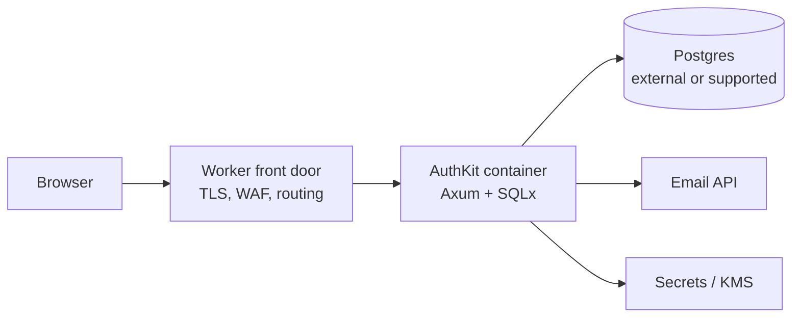

# Runtime targets

AuthKit has two first-class runtime families:

- **Native:** Axum + SQLx + SQLite or Postgres, running as a normal Rust process.
- **Workers:** workers-rs + D1, running in the Cloudflare Workers isolate runtime.

They share the domain core and application use cases, but they are not feature-identical.
The Workers target is intentionally a **Workers-lite** profile. Pretending otherwise would
produce insecure password hashing, non-atomic writes, or silent data loss. This document
defines the support matrix, the platform constraints that drive it, and the spike work
required before committing to parity claims.

Related documents:

- [Architecture](architecture.md)
- [Domain model](domain-model.md)
- [Standards](standards.md)

## 1. Support matrix

Legend: **Full** = production-supported; **Caveat** = supported with documented limits;
**Lite** = available only in the Workers-lite profile; **No** = not supported.

| Capability | Native + SQLite | Native + Postgres | Workers + D1 |
| --- | --- | --- | --- |
| OIDC discovery, JWKS | Full | Full | Full |
| Authorization code + PKCE | Full | Full | Full |
| Client credentials | Full | Full | Full |
| Refresh rotation and reuse detection | Full | Full | Caveat (read replication) |
| Userinfo | Full | Full | Full |
| RP-initiated logout | Full | Full | Full |
| Token revocation | Full | Full | Caveat (propagation) |
| Host-only session UI | Full | Full | Full |
| Organizations, applications, clients | Full | Full | Full |
| Memberships, roles, permissions | Full | Full | Full |
| Audit write and review | Full | Full | Caveat (volume/export) |
| Password authentication (Argon2id) | Full | Full | No by default; decision pending |
| Passkeys / WebAuthn | Decision pending | Decision pending | Decision pending |
| TOTP MFA | Decision pending | Decision pending | Decision pending |
| Email verification / reset | Full | Full | Full via email API |
| SMTP delivery | Full | Full | No |
| Background jobs | Full (in-process/outbox) | Full (outbox/worker) | Queues + Cron |
| Interactive SQL transactions | Full | Full | No |
| Multi-replica serving | No (single writer) | Full | Platform-managed |
| Restore/backup tooling | Full | Full | Platform D1 tooling |
| SAML, SCIM, LDAP, outposts | No | No | No |

The matrix is a product contract, not an aspiration. Any capability marked **Caveat** or
**Lite** must be visible in deployment documentation and in the admin UI.

## 2. Why SQLx cannot run on Workers

SQLx is a native Rust database library. It depends on a Tokio runtime, socket I/O, and
database wire protocols. The Workers runtime is a V8 isolate with:

- no filesystem and no arbitrary process spawning;
- no general-purpose TCP unless the platform exposes a socket API, and even then no native
  library stack;
- a WebAssembly compilation target (`wasm32-unknown-unknown`) with restricted system
  interfaces;
- CPU and memory limits per request;
- bindings rather than connection strings for platform services.

SQLx has no D1 driver. D1 is accessed through the Workers binding
(`env.DB.prepare(...).bind(...).all()/first()/run()` or `batch()`) or the D1 HTTP API. A
native `sqlx::PgPool` cannot be compiled to the Workers target, and pointing SQLx at an
HTTP proxy would be a new, unsupported database protocol with transaction and pooling
semantics that do not match Postgres.

Consequences:

- The SQLx and D1 implementations are separate modules behind the same ports in
  `authkit-store`, with the D1 path compiled only for the Workers target.
- The D1 adapter does not reuse SQLx query macros, migrator, or connection pool.
- Migrations have a shared logical sequence but separate execution paths.
- Integration tests run the same domain contract suite against both adapters.

**Decision pending:** whether the workspace builds the Workers crate by default on a
native host. The recommended setup is feature-gated workspace members so `cargo test
--workspace` does not require the Workers toolchain, plus a dedicated CI job for
`wasm32-unknown-unknown`.

## 3. D1 transaction and consistency constraints

### 3.1 No interactive transactions

D1 does not support `BEGIN`, `COMMIT`, or holding a transaction open across multiple
round trips. It provides `batch()`, which executes a list of prepared statements
sequentially and treats the batch as a transaction: a failure aborts the batch and rolls
back its statements. That is useful, but it is not the same as an interactive transaction:

- You cannot read a value, branch on it, and write within the same transaction.
- You cannot do a long-running multi-step workflow with locks held.
- Each statement must be fully specified before the batch is submitted.
- The batch has size and statement limits that must be measured, not assumed.

AuthKit therefore uses the **guarded write batch** described in
[Architecture](architecture.md):

1. Read the state needed for the decision.
2. Compute all new rows and hashes in Rust.
3. Submit a batch whose statements contain compare-and-set guards
   (`consumed_at IS NULL`, `version = ?`, `revoked_at IS NULL`).
4. Inspect the result. A guard failure means conflict, replay, or lost race; fail closed.

This pattern is mandatory for authorization-code consumption, refresh rotation, session
rotation, last-owner protection, invitation acceptance, and client-secret rotation. A use
case that cannot be expressed this way is not Workers-compatible.

### 3.2 Rows affected and statement results

The D1 adapter must verify that each guarded statement actually changed the expected number
of rows. D1 returns metadata per statement in a batch. The adapter maps this to the port's
`WriteOutcome` (`Applied`, `Conflict`, `NotFound`). It must not assume success because the
batch call returned without an exception.

### 3.3 Read replication and stale reads

D1 read replication can route reads to replicas. Replicas are eventually consistent.
Without a session or bookmark, a read immediately after a write can observe an older
snapshot.

Implications for AuthKit:

- **Login and session checks** are authorization-critical. Reads used to decide whether a
  session is revoked, whether a refresh token is consumed, or whether a membership is still
  active must be consistent with the write that changed them.
- **Refresh-token reuse detection** cannot tolerate a stale read of `consumed_at`. A stale
  read could accept a replayed token or reject a valid successor.
- **Revocation propagation** is bounded by replication lag. A revoked session or refresh
  family may still appear active on a replica. Access tokens remain valid until expiry
  regardless, so revocation is already bounded by token TTL.
- **Admin reads** (lists, audit review) can tolerate bounded staleness if the UI labels it.

Mitigations, in order of preference:

1. Force auth-critical reads to the primary using the D1 Sessions API
   (`withSession("first-primary")` or an equivalent primary-consistency session) where the
   workers-rs binding exposes it.
2. After a sensitive write, use the session bookmark for subsequent reads in the same
   request. If the binding does not expose bookmarks, fail closed by using a primary-only
   path or a dedicated D1 database without read replication.
3. Keep access-token lifetimes short and make refresh rotation the revocation choke point.
4. Do not cache authorization decisions in KV or in isolate memory beyond the request.
   KV is eventually consistent and has no transactional relationship with D1.
5. If read replication cannot be disabled or primary reads cannot be guaranteed, do not
   claim Workers support for refresh-token reuse detection or immediate session revocation.
   **Decision pending:** whether Workers deployments must disable read replication in v1.

### 3.4 Revocation caveats

Even on native Postgres, stateless JWT access tokens are not instantly revocable. On
Workers the gap can be wider:

- A logout revokes the AuthKit session and refresh family. It does not invalidate already
  issued access tokens at resource servers.
- A resource server that needs immediate revocation must use introspection, a shared
  denylist with acceptable propagation, or very short access-token TTLs plus refresh
  revocation.
- D1 read replication can delay visibility of the revocation record itself. The
  introspection endpoint must use primary-consistent reads for revocation state.
- Token cleanup jobs must not delete revocation evidence before the maximum token lifetime
  has elapsed.

Document these caveats in the deployment guide rather than implying instant global logout.

### 3.5 Size and query limits

D1 imposes database size, query duration, rows-read, rows-written, batch-size, and
bound-parameter limits that differ from SQLite and Postgres and can change. The adapter
must:

- paginate every list query with keyset pagination;
- cap audit queries and exports;
- avoid unbounded `IN (...)` lists;
- keep batches small enough for the platform;
- avoid expensive joins on hot paths;
- enforce a maximum request body size at the Worker boundary.

Exact limits belong in the compatibility spike results, not hard-coded assumptions in the
domain.

## 4. Argon2 on Workers

Argon2id is the native password hashing choice. It is memory-hard and deliberately
expensive. That is good for offline cracking resistance and awkward for an isolate
runtime.

Constraints:

- Workers isolates have a memory ceiling and per-request CPU limits. Limits vary by plan
  and change over time.
- Argon2 with multiple lanes wants threads. Workers does not provide general shared-memory
  threads to a WASM module. Use `p=1` if Argon2 is used at all.
- A WASM Argon2 build plus the request, templates, and D1 client share the same memory
  budget.
- Password verification is attacker-triggerable. A login endpoint with expensive hashing is
  a denial-of-service amplifier unless rate limits and concurrency controls exist.
- Workers CPU time is billed and capped. A parameter set that is fine on a native server can
  exceed the limit under load.

Options:

| Option | Security | Operability | Recommendation |
| --- | --- | --- | --- |
| Argon2id in WASM on Workers | Best password KDF if parameters fit | Fragile under CPU/memory limits; DoS risk | Not default; spike only |
| PBKDF2-HMAC-SHA-256 via WebCrypto | Weaker against GPU/ASIC than Argon2; widely available | Predictable native implementation; still CPU-costly at high iterations | Acceptable only as a documented Workers-lite tradeoff |
| Disable passwords on Workers; use passkeys and/or email links | Removes password KDF risk | Requires email deliverability and WebAuthn support | Preferred Workers-lite default |
| Offload password verification to a native service | Preserves Argon2id | Adds a service dependency and latency; violates "Workers-only" simplicity | Acceptable for hybrid deployments |
| Run native in Cloudflare Containers | Preserves Argon2id | Container cold starts and cost | Escape hatch, not the default |

The domain core exposes a `PasswordHasher` port. The Workers adapter must not silently
substitute a weaker algorithm for an existing hash. If a deployment migrates from native to
Workers, password credentials either remain on a native verification service or users are
required to reset and enroll a supported credential. **Decision pending:** the exact
Workers-lite password policy. The safe default is **no password authentication on
Workers** until benchmarks prove a parameter set within platform limits.

Constant-time comparison, per-hash salts, and rehash-on-login apply on every runtime. Never
store a fast unsalted hash and call it a password hash.

## 5. OIDC key storage and signing

### 5.1 Common requirements

- Asymmetric signing only for OIDC tokens. Default ES256; EdDSA optional where verified.
- Public JWKS with stable `kid` values; private keys never leave the server.
- Key states: `next` (published, not signing), `active`, `retired` (published until the
  maximum token lifetime passes).
- Rotation is audited and does not invalidate tokens signed by a still-published key.
- Private keys are encrypted at rest and decrypted only into process memory.
- The discovery document's `id_token_signing_alg_values_supported` matches reality.

### 5.2 Native

Recommended storage:

- Generate the keypair at bootstrap or via `authkit-server key generate`.
- Encrypt the private key with AES-256-GCM using a master key from the environment, a
  mounted secret file, or a KMS. Store the ciphertext and metadata in `signing_key`.
- Keep the master key out of the database and out of backups of the database.
- Load the active key into memory at startup; sign with a pure-Rust or ring-backed signer.
- Publish all non-retired public keys in JWKS.
- For higher assurance, integrate a KMS/HSM signing interface behind the `TokenSigner`
  port. **Decision pending:** which KMS providers are supported in v1.

SQLite deployments need the same discipline: an encrypted database file does not protect a
key stored beside it. Use full-disk encryption plus application-level key encryption.

### 5.3 Workers

Workers has no general filesystem and no direct HSM. Options:

- **Worker secret:** a JSON keyring containing one or more private JWKs, provided via a
  secret binding. Import with WebCrypto or a pure-Rust signer. Rotation requires updating
  the secret and deploying or restarting the Worker version. Small and simple; no runtime
  key generation without persisting the key.
- **Encrypted key rows in D1:** store ciphertext in `signing_key`, with a key-encryption
  key in a Worker secret. This permits runtime rotation without a redeploy, but places
  encrypted private keys in the database. An attacker with both the D1 export and the
  secret wins; an attacker with only the database does not.
- **Secrets Store:** use the platform's secret-management binding where available. Verify
  binding support, size limits, rotation semantics, and whether the value is readable by
  the Worker at runtime. KV is not a secret store: it is eventually consistent, readable by
  any Worker binding with access, and not designed for private key custody.
- **External signing service:** a native service or container holds the key and exposes a
  narrow sign endpoint. The Worker never sees the private key. This adds a critical
  dependency and latency but is the strongest separation available without an HSM binding.

Signing implementation:

- ES256 over P-256 with SHA-256 is the portability baseline. Verify support in the chosen
  Rust crypto crate on `wasm32-unknown-unknown` and in WebCrypto.
- Ed25519 support varies by runtime and client library. Do not advertise it until the
  compatibility spike verifies signing, verification, JWKS encoding, and client
  interoperability.
- Do not use HS256 for OIDC clients. A shared secret cannot be distributed safely to
  resource servers and public clients.
- Test key rotation by signing with the old key, rotating, and verifying that JWKS still
  contains the old `kid` until tokens expire.

**Decision pending:** Worker secret keyring versus encrypted D1 keys. The default
recommendation is a secret keyring for small deployments and encrypted D1 keys only when
runtime rotation is a hard requirement.

## 6. Email and background jobs

### 6.1 Email

Native:

- SMTP via a Rust email library, or an HTTP transactional-email API.
- Connection pooling, timeouts, retries with backoff, and a suppression list.
- SPF, DKIM, and DMARC are deployment responsibilities. AuthKit documents the required DNS
  records and the envelope-from/header-from expectations.

Workers:

- No SMTP. Use an HTTP transactional-email API (for example, a provider's REST API) with an
  API key stored as a secret.
- Cloudflare Email Routing's send binding is restricted to verified destination addresses
  and is not a general user-email solution. It is unsuitable for password resets to
  arbitrary users unless the deployment's constraints match.
- Email sends are outbound subrequests and count against subrequest limits. Batch and
  queue them; do not send inside the login request's critical path when avoidable.
- Bounce and complaint webhooks must be verified and processed idempotently.

Portable pattern: write an `outbox` row in the same guarded batch as the state change, then
drain it asynchronously.

### 6.2 Jobs

Native:

- A Tokio background worker polls the outbox, claims jobs with a guarded update, executes,
  and records attempts.
- Scheduled tasks use an internal scheduler or an external cron triggering a CLI command.
- Job execution must be idempotent; at-least-once is the default.

Workers:

- Cloudflare Queues for asynchronous delivery. Queues are at-least-once; consumers must be
  idempotent and deduplicate by event ID.
- Cron Triggers for cleanup, expired-token removal, key-state checks, and outbox sweeps.
- Durable Objects only if a single-coordinator guarantee is genuinely needed (for example,
  rate-limit buckets or a rotation lock). Do not make every request depend on a DO.
- Workflows are not required for v1; adding them increases platform coupling.
- Queue message size and retry limits constrain payloads. Store the canonical event in D1
  and put only the event ID in the message when payloads are large.

**Decision pending:** whether audit fan-out uses Queues on Workers or is written
synchronously in the request batch. The recommendation is synchronous audit insert in the
guarded batch for security-relevant events, with asynchronous export.

## 7. Hyperdrive caveat

Cloudflare Hyperdrive accelerates Workers access to **Postgres and MySQL** over TCP. It
does not make SQLx run on Workers, and it does not front D1.

If a hybrid deployment uses Hyperdrive:

- The Worker must use a Workers-compatible Postgres driver, not SQLx.
- Hyperdrive pools connections and may cache query results. Cached reads can be stale.
  Auth-critical queries must disable caching or use a path that bypasses the cache.
- Transaction-pooling behavior can break session-level features, prepared-statement
  assumptions, advisory locks, and `LISTEN/NOTIFY`. AuthKit's guarded-batch model avoids
  most of these, but migrations and maintenance jobs must be tested.
- Hyperdrive is not a substitute for a native runtime. It is a way to reach an external
  Postgres from a Worker.
- Cloudflare Containers can use platform networking to reach Postgres; verify whether
  Hyperdrive is supported for the container path before designing around it.

**Decision pending:** whether any official topology uses Hyperdrive. The default
Workers topology uses D1; the default full-feature Cloudflare topology uses Containers with
Postgres.

## 8. Workers-lite feature set

Workers-lite is a named profile, not an accident. It targets small organizations and
edge-native deployments that accept these constraints:

Included:

- OIDC discovery and JWKS.
- Authorization code + PKCE for confidential BFF clients and public native/CLI clients.
- Client credentials for service clients.
- Refresh-token rotation with primary-consistent reads, or no refresh tokens if primary
  reads cannot be guaranteed. **Decision pending.**
- Userinfo.
- RP-initiated logout and token revocation, with documented propagation caveats.
- AuthKit session UI and organization/application administration.
- Organizations, applications, OAuth clients, memberships, roles, permissions.
- Audit writes and a bounded audit viewer/export.
- Email verification and password reset via an email API, if the deployment configures
  one.
- Passkeys/WebAuthn if the MFA spike succeeds.
- Rate limiting backed by D1, KV, or a Durable Object with documented consistency.

Excluded or restricted:

- Password authentication by default (Argon2 risk).
- SMTP.
- Interactive transactions and any use case that requires them.
- Large audit exports, unbounded search, and heavy reporting.
- SAML, SCIM, LDAP, outposts, auth proxy, visual flow builders.
- Cross-region strong consistency for revocation without a primary-consistent read path.
- Custom domains per organization. One issuer per deployment; host-only cookies.

The profile must be enforced in code. A runtime capability descriptor should hide or
disable unsupported admin controls, and the API must reject unsupported operations with a
clear error rather than failing deep in an adapter.

## 9. Cloudflare Containers escape hatch

Cloudflare Containers can run the native AuthKit image inside Cloudflare's network. This is
the recommended escape hatch when a team wants Cloudflare operations but needs the full
feature set.

Shape:

Properties:

- Full native behavior: Argon2id, interactive transactions, SQLx migrations, background
  jobs, SMTP or API email.
- The Worker handles edge routing and static assets if desired; the container handles
  dynamic auth traffic.
- Containers have cold starts, scale-to-zero behavior, memory/CPU sizing, and regional
  placement that differ from isolates. Session state remains in Postgres, never container
  disk.
- D1 is not the container's database. Use Postgres. The container can reach external
  Postgres; verify Hyperdrive and private networking support for the chosen plan.
- Container images must be pinned, scanned, and updated. The supply-chain surface is larger
  than a Worker.
- Cost and operational complexity are higher than Workers-lite but lower than running a
  Kubernetes cluster.

**Decision pending:** support tier for Containers (officially supported versus documented
community pattern). The architecture permits it; the product promise needs an explicit
answer.

## 10. Compatibility spike checklist

The Workers target is not declared supported until these spikes pass and their results are
recorded. Each item has a concrete pass condition.

### Build and runtime

- [ ] The domain, application, crypto, UI, and D1 crates compile to
  `wasm32-unknown-unknown` without native-only dependencies (`tokio`, `ring` unless
  verified, OpenSSL, `libsqlite3-sys`).
- [ ] `getrandom` uses the Workers-compatible backend; ID generation and token generation
  work without a filesystem or OS entropy assumptions.
- [ ] Askama templates compile into the WASM binary and render correctly from a Worker
  response, including escaped and unescaped contexts.
- [ ] Multiple `Set-Cookie` headers can be emitted correctly; `__Host-` cookies work over
  HTTPS; no `Domain` attribute is added.
- [ ] Request body limits and streaming behavior are understood for form posts and token
  requests.

### D1

- [ ] A failing statement in `batch()` rolls back prior statements in the same batch.
- [ ] Per-statement rows-affected metadata is available and mapped to `Applied`/`Conflict`.
- [ ] A guarded authorization-code consumption succeeds once and fails on replay under
  concurrent requests.
- [ ] Refresh rotation with reuse detection behaves correctly under concurrency.
- [ ] D1 read replication behavior is measured: write-then-read visibility, session
  bookmarks, and `first-primary` reads from workers-rs or the underlying binding.
- [ ] Revocation visibility is measured for sessions, refresh families, and introspection.
- [ ] Database, batch, statement, parameter, and query limits are recorded with headroom
  targets.
- [ ] Migrations apply from empty and from the previous schema version using the D1 path.

### Argon2 and credentials

- [ ] Argon2id WASM with `p=1` is benchmarked at candidate parameters for CPU time and
  memory under the target Workers plan.
- [ ] Concurrent login load is tested to find the denial-of-service threshold.
- [ ] The chosen Workers-lite credential policy is enforced at the API and UI layers, with
  no silent downgrade of existing hashes.
- [ ] WebAuthn registration and assertion verification work on Workers if passkeys are in
  scope.

### Keys and tokens

- [ ] ES256 signing works on Workers with the chosen crypto implementation.
- [ ] JWKS encoding, `kid` selection, and discovery metadata are correct.
- [ ] Key rotation publishes old and new keys for the overlap window and old tokens verify.
- [ ] Private key storage option (secret keyring versus encrypted D1) is tested, including
  rotation and recovery.
- [ ] Access tokens validate at a sample resource server; ID tokens cannot be used as access
  tokens.

### Email, jobs, and operations

- [ ] Email API calls work within subrequest limits and are queued outside the login path.
- [ ] Outbox drain is idempotent under at-least-once delivery.
- [ ] Queue retry and dead-letter behavior is understood; poison messages do not loop
  forever.
- [ ] Cron cleanup jobs run within CPU and duration limits.
- [ ] Structured logs redact tokens, passwords, cookies, and email bodies.
- [ ] Rate limiting behaves correctly across isolates and regions, or its limits are
  documented.
- [ ] A load test covers login, token exchange, refresh, and JWKS under expected tenant
  size.
- [ ] Backup/export and restore are tested with the platform's D1 tooling.

### Product and documentation

- [ ] The Workers-lite profile hides unsupported features in the admin UI and rejects them
  in the API.
- [ ] Deployment docs state the revocation and read-replication caveats in plain language.
- [ ] A native-to-Workers migration note explains password and key implications.
- [ ] The Containers path is tested with the native image and Postgres.

Until this checklist is complete, Workers support is a preview. The native runtime is the
reference implementation.

## 11. Open runtime decisions

1. Workers-lite password policy: none, PBKDF2, WASM Argon2, or native verification service.
2. Whether Workers deployments must disable D1 read replication for auth-critical
   correctness.
3. Workers key custody: secret keyring, encrypted D1, Secrets Store, or external signer.
4. Ed25519 support and whether it is advertised.
5. Passkeys/WebAuthn and TOTP in v1, and whether they are available on Workers.
6. Email provider abstraction and bounce/complaint handling.
7. Official support tier for Cloudflare Containers.
8. Whether refresh tokens are issued at all when primary-consistent D1 reads are
   unavailable.

See [Architecture](architecture.md) for topology context and
[Domain model](domain-model.md) for the atomicity requirements these decisions must
preserve.
